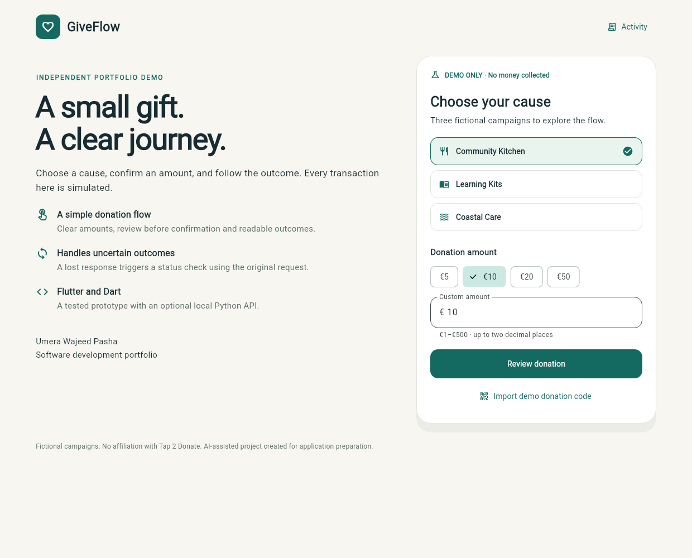
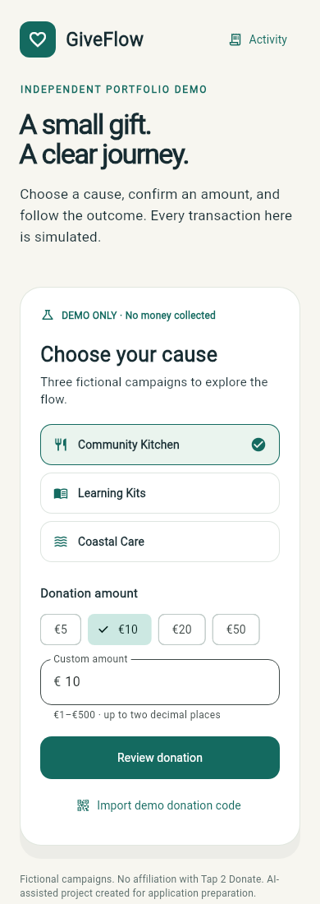

# GiveFlow donation workflow demo

Independent, AI-assisted portfolio project prepared for Umera Wajeed Pasha's software developer application. Fictional campaigns and simulated payments only. No affiliation with Tap 2 Donate and no production payment integration.

This is a real Flutter/Dart app with a browser-local simulation gateway and an optional Python FastAPI/SQLite backend. It covers amount selection, review, confirmation, success, decline, offline retry and recovery after an uncertain response. No card details are collected.

## Try the flow

1. Choose Community Kitchen, Learning Kits or Coastal Care.
2. Pick a preset or enter a EUR amount between 1 and 500 with at most two decimal places.
3. Review the campaign, amount and currency before confirming.
4. Select Success, Declined, Response timeout or Offline from the test-outcome menu.
5. After a timeout, use **Check donation status**. The original request is reconciled without creating another donation.
6. Open Activity for distinct successful and declined simulated receipts.
7. Import `giveflow://donate?campaign=learning&amount=12.50` to validate a sample payload. This is pasted-code input, not camera scanning or NFC reading.




## Run Flutter

Validated with Flutter 3.35.7 and its bundled Dart SDK. `pubspec.lock` records Dart dependencies. Install the SDK from https://docs.flutter.dev/install/archive and add `flutter/bin` to PATH.

```bash
flutter pub get
flutter run -d chrome
```

Default mode persists demo receipts and unresolved requests locally using SharedPreferences. An uncertain request remains uncertain after reload until its original key is checked. Clear this site's browser data to reset its local demo records.

An Android project is supplied. With an Android SDK and emulator or connected device, use `flutter run -d <device-id>`. Android builds and device behaviour were not verified here. iOS project files and an iOS build are not supplied.

## Optional local Python API

Use Python 3.12 and a virtual environment. From the repository root:

```bash
python -m venv .venv
# macOS / Linux
source .venv/bin/activate
# Windows PowerShell: .venv\Scripts\Activate.ps1
python -m pip install -r backend/requirements-lock.txt
python -m uvicorn backend.app:app --host 127.0.0.1 --port 8021
```

In a second terminal:

```bash
flutter run -d chrome --web-hostname localhost --web-port 8080 --dart-define=API_BASE_URL=http://127.0.0.1:8021
```

The API uses local SQLite and exposes documentation at http://127.0.0.1:8021/docs. Browser CORS is restricted to the documented local origin. Keep the API on loopback; authentication and production hardening are outside this demo's scope.

For an Android emulator the host API is normally reachable at `http://10.0.2.2:8021`, but this was not tested. The release Android manifest is for local simulation mode; configure debug-only networking deliberately if adding API mode on a device.

## Validate

```bash
flutter analyze
flutter test --reporter=expanded
python -m pytest backend/test_api.py -q
python scripts/run_contract_test.py --flutter-bin flutter
flutter build web --release --no-web-resources-cdn
```

Two live HTTP tests intentionally skip in the ordinary Flutter suite and run through `run_contract_test.py`, which starts a temporary loopback API with a disposable database and closes it afterwards. Golden images are actual Flutter widget renders, visually inspected during preparation, not browser screenshots. Linux golden baselines can differ on other operating systems; review changes before accepting them.

## Architecture

- `lib/donation.dart`: integer-cents validation, strict payload parsing, receipts, gateway interfaces and donation state machine.
- `lib/main.dart`: responsive amount, review and outcome screens and activity view.
- `DemoGateway`: SharedPreferences demonstration persistence.
- `ApiGateway`: actual HTTP adapter for local FastAPI mode.
- `backend/app.py`: request validation, unique idempotency keys, SQLite locking and status lookup.
- `test/`: unit, functional widget, live contract and visual tests.

Each attempt gets a random request key. The API uses a unique key and `BEGIN IMMEDIATE` so concurrent repeats return the same receipt. A key reused for different donation details is rejected. A simulated timeout happens after the receipt is committed, demonstrating why a missing response cannot be treated as a failed payment.

## Boundaries and authorship

- Fictional campaigns, outcomes and receipts. No payment SDK, card storage, OCR, camera scanning or NFC integration.
- Browser-local storage is demonstration persistence, not a shared ledger. Cross-tab coordination is not guaranteed; the optional API demonstrates concurrency handling.
- No Android APK, iOS build or real-device verification is claimed.
- Web compilation and widget renders do not replace deployed-browser QA.
- Source, tests and documentation were substantially created with AI assistance. Review, run and explain the code before representing independent proficiency.

The source is versioned for the hosted demo. To publish under the candidate's GitHub account, follow `docs/GITHUB_PUBLISHING.md`; no such GitHub repository was created here. See `docs/DEMO_WALKTHROUGH.md`, `docs/TEST_RESULTS.md` and `docs/EVIDENCE.md`.
